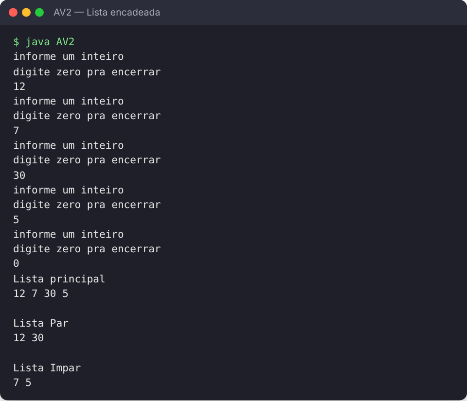

# AV2 · Estruturas de Dados — Lista encadeada de pares e ímpares

Solução da segunda avaliação (AV2) de **Estruturas de Dados** em Java. O programa lê inteiros até o usuário digitar `0`, guarda tudo em uma **lista simplesmente encadeada** implementada do zero e depois separa os valores em duas novas listas: **pares** e **ímpares**.



## Estrutura

| Arquivo | Responsabilidade |
|---|---|
| `LSEnode.java` | Nó da lista: valor (`info`) e referência para o próximo |
| `LSEint.java` | Lista simplesmente encadeada de inteiros: `inserir`, `isEmpty`, `exbir` e `paresEImpares` |
| `AV2.java` | Programa principal: leitura dos valores e exibição das três listas |

O método `paresEImpares(par, impar)` percorre a lista uma única vez (O(n) visitas) e insere cada valor na lista correspondente.

## Como executar

```bash
javac *.java
java AV2
```

## Tecnologias

Java (sem bibliotecas externas)

---

Feito por [João Pedro Pimenta](https://www.linkedin.com/in/joao-pedro-pimenta/) durante a graduação em Ciência da Computação na UNICAP.
